# FULL STACK SOFTWARE ENGINEERING
### Sıfırdan peşəkarlığa — kompleks öyrənmə xəritəsi

         

**FOUNDATIONS / ENGINEERING / DEVELOPMENT / SECURITY / INFRASTRUCTURE**

| Parametr | Təsvir |
|---|---|
| Başlanğıc səviyyəsi | Heç bir proqramlaşdırma biliyi tələb olunmur |
| Hədəf | Müstəqil Full Stack Software Developer |
| Tövsiyə olunan müddət | 12–18 ay |
| Gündəlik çalışma | 2–4 saat |
| Metodologiya | Nəzəriyyə, praktika, araşdırma və real layihələr |
| Əsas dil | Azərbaycan dili |
| Texniki terminologiya | İngilis dili |

> Proqramlaşdırma sadəcə kompüterə nə etməli olduğunu demək deyil. Problemi anlamaq, onu hissələrə ayırmaq, həll yolları yaratmaq və həmin həllərin nəticələrinə görə məsuliyyət daşımaqdır.

---

# 00 — Ümumi yol xəritəsi

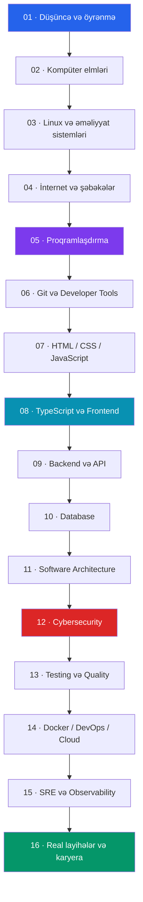

Bu roadmap-da məqsəd bütün texnologiyaları əzbərləmək deyil. Məqsəd texnologiyalar arasındakı əlaqələri anlamaq və yeni texnologiyanı müstəqil öyrənə biləcək səviyyəyə çatmaqdır.

---

# 01 —  Düşüncə, öyrənmə və mühəndislik

`FOUNDATION` · `MINDSET` · `PROBLEM SOLVING`

## 1.1. Proqramçı olmaq nə deməkdir?

Proqramçı yalnız kod yazan insan deyil. Proqramçı real dünyadakı problemləri kompüter vasitəsilə həll edən insandır.

| Anlayış | Mənası |
|---|---|
| Coding | Kompüter üçün təlimatlar yazmaq |
| Programming | Məntiq və alqoritmlər vasitəsilə problem həll etmək |
| Software Development | Proqram təminatını hazırlamaq və inkişaf etdirmək |
| Software Engineering | Proqram təminatını sistemli mühəndislik prinsipləri ilə qurmaq |
| Computer Science | Hesablama və informasiyanın elmi əsaslarını öyrənmək |
| Full Stack Development | Frontend, Backend və məlumat sistemləri ilə işləmək |

## 1.2. Necə düşünməyi öyrənməli?

### Computational Thinking — hesablama düşüncəsi

Dörd fundamental prinsip:

- **Decomposition:** Böyük problemi kiçik problemlərə ayırmaq.
- **Pattern Recognition:** Təkrarlanan nümunələri müəyyən etmək.
- **Abstraction:** Lazımsız detalları kənarlaşdıraraq əsas məntiqə fokuslanmaq.
- **Algorithmic Thinking:** Problemin həlli üçün ardıcıl addımlar yaratmaq.

Məsələn, elektron ticarət sistemi hazırlamaq istəyirsən. İlk addım kod yazmaq deyil.

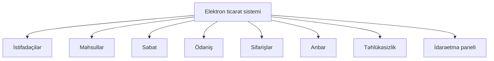

Hər bir hissə ayrıca problem kimi araşdırılır.

## 1.3. Problem həll etmə metodologiyası

1. Problemi düzgün müəyyən et.
2. Giriş məlumatlarını müəyyən et.
3. Gözlənilən nəticəni müəyyən et.
4. Məhdudiyyətləri araşdır.
5. Problemi kiçik hissələrə böl.
6. Alternativ həllər düşün.
7. Pseudocode yaz.
8. Həlli kodlaşdır.
9. Test et.
10. Nəticəni təhlil et.
11. Lazım olduqda optimallaşdır.
12. Həllini başqa bir insana izah et.

## 1.4. Öyrənməyi öyrənmək

Öyrənmək məlumatı oxumaqdan ibarət deyil.

| Metod | Tətbiqi |
|---|---|
| Active Recall | Kitaba baxmadan öyrəndiyini xatırlamaq |
| Spaced Repetition | Mövzuları müəyyən fasilələrlə təkrarlamaq |
| Feynman Technique | Mürəkkəb mövzunu sadə dildə izah etmək |
| Project-Based Learning | Real layihə hazırlayaraq öyrənmək |
| First Principles Thinking | Mövzunu fundamental prinsiplərdən anlamaq |
| Deliberate Practice | Zəif olduğun mövzular üzərində məqsədli çalışmaq |
| Mental Models | Sistemlərin necə işlədiyinə dair zehni modellər qurmaq |

### Tövsiyə olunan öyrənmə dövrü

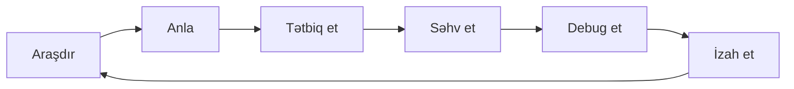

> [!IMPORTANT]
> Tutorial izləmək proqramlaşdırma bacarığı ilə eyni şey deyil. Videonu bağladıqdan sonra eyni sistemi müstəqil hazırlaya bilirsənsə, mövzunu həqiqətən öyrənməyə başlamısan.

## 1.5. Araşdırma bacarığı

Öyrənilməli vərdişlər:

- İngilis dilində texniki axtarış etmək.
- Rəsmi dokumentasiyaları oxumaq.
- Error mesajlarını tam oxumaq.
- Stack Overflow cavablarını analiz etmək.
- GitHub Issues və Discussions bölmələrindən istifadə etmək.
- Köhnəlmiş məlumatları müəyyən etmək.
- Kitabxanaların source code-unu araşdırmaq.
- Minimum Reproducible Example hazırlamaq.
- Məlumatı birdən çox mənbədən yoxlamaq.
- Bilmədiyin mövzuda düzgün sual vermək.

## 1.6. İngilis dili

Proqramlaşdırma üçün mükəmməl danışıq səviyyəsi məcburi deyil. Lakin texniki ingilis dili olduqca vacibdir.

- Documentation oxumaq.
- Error mesajlarını anlamaq.
- Texniki videolar izləmək.
- GitHub-da ünsiyyət qurmaq.
- Commit mesajları yazmaq.
- Texniki terminologiyanı anlamaq.

### Mərhələ yoxlaması

- [ ] Böyük problemi kiçik hissələrə ayıra bilirəm.
- [ ] Bir problemi kod yazmadan əvvəl analiz edə bilirəm.
- [ ] Dokumentasiyadan müstəqil istifadə edə bilirəm.
- [ ] Öyrəndiyim mövzunu sadə dildə izah edə bilirəm.
- [ ] Səhvləri öyrənmə prosesinin bir hissəsi kimi qəbul edirəm.

---

# 02 —  Peşə etikası və məsuliyyət

`ETHICS` · `RESPONSIBILITY` · `PROFESSIONALISM`

## 2.1. Etika nədir?

Etika insanın hansı davranışının doğru, hansı davranışının yanlış olduğunu müəyyənləşdirən prinsiplər sistemidir.

Proqramçının hazırladığı sistem minlərlə insanın məlumatlarına, maliyyəsinə, təhlükəsizliyinə və gündəlik həyatına təsir edə bilər.

### Peşəkar proqramçının prinsipləri

- İstifadəçi məlumatlarına hörmət etmək.
- Məxfi məlumatları paylaşmamaq.
- Başqasının kodunu mənimsəməmək.
- Lisenziya şərtlərinə riayət etmək.
- Təhlükəsizlik boşluqlarını gizlətməmək.
- Bilmədiyi mövzuda yalan danışmamaq.
- Müştəriyə real olmayan vədlər verməmək.
- İcazəsiz sistemlərə müdaxilə etməmək.
- İstifadəçini manipulyasiya edən interfeyslər hazırlamamaq.
- Hazırladığı sistemin mümkün nəticələrini düşünmək.

## 2.2. Proqram təminatı lisenziyaları

| Lisenziya | Ümumi xüsusiyyəti |
|---|---|
| MIT | Sadə və geniş istifadə imkanları |
| Apache 2.0 | Patentlərlə bağlı əlavə müddəalar |
| GPL | Paylanan törəmə proqramlar üçün copyleft tələbləri |
| AGPL | Şəbəkə üzərindən istifadəyə aid əlavə copyleft tələbləri |
| Proprietary | Müəllifin müəyyən etdiyi məhdudiyyətlər |
| Public Domain | Müəllif hüquqları məhdudiyyətlərinin olmaması və ya onlardan imtina |

Open Source proqramın mənbə kodunun açıq olması onun istənilən formada istifadəsinə avtomatik icazə verildiyi mənasına gəlmir.

## 2.3. Məxfilik və şəxsi məlumatlar

Öyrənilməli anlayışlar:

- Privacy
- Personal Identifiable Information — PII
- Data Protection
- Data Minimization
- User Consent
- Data Retention
- GDPR
- Məxfi məlumatların silinməsi
- Responsible Disclosure

### Faydalı mənbələr

- [ACM Code of Ethics](https://www.acm.org/code-of-ethics)
- [Choose a License](https://choosealicense.com/)
- [Open Source Initiative](https://opensource.org/)

---

# 03 —  Kompüter elmlərinin əsasları

`COMPUTER SCIENCE` · `HARDWARE` · `SOFTWARE`

## 3.1. Kompüter necə işləyir?

Kompüter məlumatları qəbul edən, saxlayan, emal edən və nəticə çıxaran elektron sistemdir.

| Komponent | Funksiya |
|---|---|
| CPU | Təlimatları icra edir |
| GPU | Paralel hesablamalar və qrafik emalı |
| RAM | Müvəqqəti işlək yaddaş |
| SSD / HDD | Uzunmüddətli məlumat saxlama |
| Motherboard | Komponentlər arasında əlaqə |
| Network Interface | Şəbəkə bağlantısı |
| BIOS / UEFI | Sistemin ilkin başladılması |

## 3.2. Məlumat necə saxlanılır?

Öyrən:

- Bit və Byte
- Binary — ikilik say sistemi
- Decimal — onluq say sistemi
- Hexadecimal — onaltılıq say sistemi
- ASCII
- Unicode
- UTF-8
- Integer və Floating Point
- Boolean
- Binary Files
- Text Files
- Serialization
- Compression

### Məlumat vahidləri

| Vahid | Miqdar |
|---|---|
| Bit | 0 və ya 1 |
| Byte | 8 bit |
| KB | 1 000 byte |
| MB | 1 000 KB |
| GB | 1 000 MB |
| TB | 1 000 GB |
| KiB | 1 024 byte |
| MiB | 1 024 KiB |

## 3.3. Proqram necə işləyir?

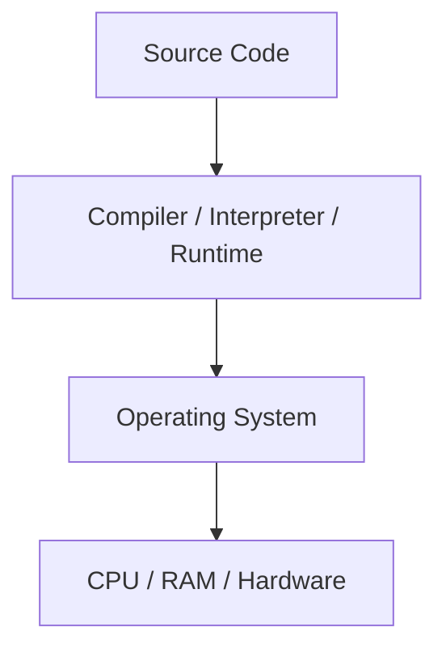

Öyrənilməli anlayışlar:

- Source Code
- Machine Code
- Assembly
- Compiler
- Interpreter
- Runtime
- Virtual Machine
- Bytecode
- JIT Compilation
- Memory Allocation
- Garbage Collection
- Stack və Heap
- Process və Thread
- Concurrency və Parallelism

## 3.4. Kompüter elmləri üçün riyaziyyat

Full Stack Developer olmaq üçün bütün ali riyaziyyatı bilmək məcburi deyil. Lakin aşağıdakı anlayışlar vacibdir:

- Məntiqi əməliyyatlar
- Boolean Algebra
- Çoxluqlar
- Funksiyalar
- Sadə ehtimal
- Statistik düşüncə
- Qraf nəzəriyyəsinin əsasları
- Kombinatorika
- İkilik say sistemi

### Resurslar

- [CS50x — Harvard](https://cs50.harvard.edu/x/)
- [Teach Yourself Computer Science](https://teachyourselfcs.com/)
- [Computer Science Field Guide](https://www.csfieldguide.org.nz/)
- [Nand2Tetris](https://www.nand2tetris.org/)
- [Crash Course Computer Science](https://www.youtube.com/@crashcourse)

---

# 04 —  Əməliyyat sistemləri və Linux

`OPERATING SYSTEMS` · `TERMINAL` · `SYSTEM ADMINISTRATION`

## 4.1. Əməliyyat sistemi nədir?

Operating System — OS kompüterin hardware resurslarını idarə edən və proqramların işləməsini təmin edən sistem proqram təminatıdır.

| Əməliyyat sistemi | İstifadə sahəsi |
|---|---|
| Windows | Şəxsi kompüterlər və biznes |
| macOS | Apple kompüterləri |
| Linux | Serverlər, cloud, development |
| Android | Mobil cihazlar |
| iOS | Apple mobil cihazları |
| FreeBSD | Server və xüsusi sistemlər |

## 4.2. Linux nədir?

Linux texniki olaraq əməliyyat sistemi nüvəsidir — kernel. Ubuntu, Debian, Fedora və Arch Linux kimi distributivlər bu nüvə ətrafında qurulmuş sistemlərdir.

### Nə üçün proqramçı Linux bilməlidir?

- Web serverlərin böyük hissəsi Linux üzərində işləyir.
- Docker və cloud ekosistemində geniş istifadə olunur.
- Server idarəetməsini asanlaşdırır.
- Avtomatlaşdırma üçün güclü alətlər təqdim edir.
- Əməliyyat sistemlərinin iş prinsipini anlamağa kömək edir.

Windows istifadəçiləri başlanğıc üçün WSL2 və Ubuntu istifadə edə bilərlər.

## 4.3. Fundamental OS anlayışları

- Kernel və User Space
- File System
- Process Management
- Memory Management
- Virtual Memory
- Permissions
- Users və Groups
- System Calls
- Environment Variables
- Services və Daemons
- Package Managers
- Drivers
- Virtualization

## 4.4. Terminal nədir?

Terminal əməliyyat sistemi ilə mətn əsaslı ünsiyyət qurmaq üçün istifadə edilən interfeysdir.

Shell isə yazılan əmrləri interpretasiya edən proqramdır.

Məsələn: Bash, Zsh, PowerShell.

### Əsas Linux əmrləri

| Əmr | Funksiya |
|---|---|
| `pwd` | Cari qovluğu göstərir |
| `ls` | Faylları siyahıya alır |
| `cd` | Qovluğu dəyişir |
| `mkdir` | Qovluq yaradır |
| `touch` | Fayl yaradır və ya vaxtını yeniləyir |
| `cp` | Faylı kopyalayır |
| `mv` | Faylı daşıyır və ya adını dəyişir |
| `rm` | Faylı silir |
| `cat` | Fayl məzmununu göstərir |
| `grep` | Mətn daxilində axtarış edir |
| `find` | Faylları axtarır |
| `chmod` | Fayl icazələrini dəyişir |
| `chown` | Fayl sahibini dəyişir |
| `ps` | Prosesləri göstərir |
| `top` | Sistem resurslarını izləyir |
| `curl` | Şəbəkə sorğuları göndərir |
| `ssh` | Uzaq serverə qoşulur |
| `df` | Disk istifadəsini göstərir |
| `free` | Yaddaş istifadəsini göstərir |
| `systemctl` | Systemd servislərini idarə edir |

## 4.5. Bash Scripting

Öyrən:

- Variables
- Conditions
- Loops
- Functions
- Pipes
- Input / Output Redirection
- Exit Codes
- Cron Jobs
- Environment Variables

### Praktiki tapşırıq

- [ ] Ubuntu və ya WSL2 quraşdır.
- [ ] Terminal vasitəsilə layihə qovluğu yarat.
- [ ] Git və Node.js quraşdır.
- [ ] Sadə Bash script yaz.
- [ ] SSH açarı yarat.
- [ ] Fayl icazələrini araşdır.
- [ ] İşləyən prosesləri və sistem loglarını yoxla.

### Resurslar

- [Linux Journey](https://linuxjourney.com/)
- [The Missing Semester — MIT](https://missing.csail.mit.edu/)
- [OverTheWire Bandit](https://overthewire.org/wargames/bandit/)
- [ExplainShell](https://explainshell.com/)

---

# 05 —  İnternet və şəbəkələr

`NETWORKING` · `INTERNET` · `PROTOCOLS`

## 5.1. İnternet nədir?

İnternet müxtəlif kompüterlərin və şəbəkələrin standart protokollar vasitəsilə bir-biri ilə əlaqə saxladığı qlobal infrastrukturdur.

Web isə internet üzərində işləyən xidmətlərdən biridir.

## 5.2. Öyrənilməli şəbəkə anlayışları

| Anlayış | İzah |
|---|---|
| IP Address | Şəbəkədə cihazın məntiqi ünvanı |
| MAC Address | Şəbəkə interfeysinin identifikatoru |
| DNS | Domen adlarını uyğun DNS qeydlərinə çevirən sistem |
| Domain | İnsanların oxuya bildiyi internet adı |
| Port | Şəbəkə xidmətinin məntiqi əlaqə nöqtəsi |
| Router | Şəbəkələr arasında paketləri yönləndirir |
| Firewall | Şəbəkə trafikini qaydalara əsasən idarə edir |
| TCP | Etibarlı və ardıcıl məlumat ötürülməsi |
| UDP | Bağlantısız məlumat ötürülməsi |
| HTTP | Web məlumat mübadiləsi protokolu |
| HTTPS | TLS ilə qorunan HTTP |
| TLS | Şifrələnmiş və autentifikasiya olunan əlaqə |
| Proxy | Sorğular üçün vasitəçi server |
| Reverse Proxy | Backend serverlərin qarşısındakı vasitəçi |
| VPN | Qorunan virtual şəbəkə bağlantısı |
| CDN | Məzmunun istifadəçilərə yaxın nöqtələrdən çatdırılması |
| WebSocket | Davamlı, ikitərəfli əlaqə |
| Latency | Məlumat ötürülməsində gecikmə |
| Bandwidth | Şəbəkənin ötürmə tutumu |

## 5.3. Brauzerə sayt ünvanı yazanda nə baş verir?

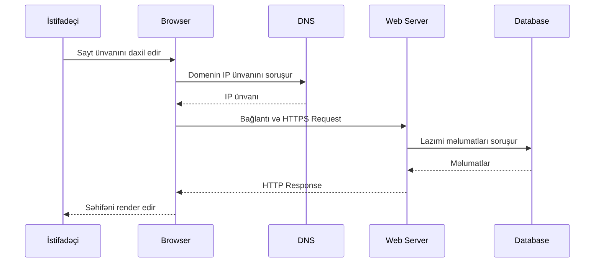

Bu, sadələşdirilmiş modeldir. Keşləmə, CDN və digər mexanizmlər real sistemdə əlavə mərhələlər yarada bilər.

## 5.4. HTTP metodları

| Metod | Məqsəd |
|---|---|
| GET | Resursu əldə etmək |
| POST | Məlumat göndərmək və əməliyyat yaratmaq |
| PUT | Resursu tam əvəz etmək |
| PATCH | Resursu qismən dəyişmək |
| DELETE | Resursu silmək |
| HEAD | Response body olmadan metadata əldə etmək |
| OPTIONS | Dəstəklənən əlaqə imkanlarını öyrənmək |

## 5.5. HTTP status kodları

| Kod | Mənası |
|---|---|
| 200 | OK |
| 201 | Created |
| 204 | No Content |
| 301 | Moved Permanently |
| 304 | Not Modified |
| 400 | Bad Request |
| 401 | Unauthorized |
| 403 | Forbidden |
| 404 | Not Found |
| 409 | Conflict |
| 429 | Too Many Requests |
| 500 | Internal Server Error |
| 502 | Bad Gateway |
| 503 | Service Unavailable |

### Praktiki tapşırıq

- [ ] Browser DevTools Network panelini araşdır.
- [ ] `curl` ilə HTTP request göndər.
- [ ] Request və Response header-lərini analiz et.
- [ ] DNS sorğusu həyata keçir.
- [ ] Localhost və port anlayışlarını izah et.
- [ ] HTTP və HTTPS fərqini öyrən.

### Resurslar

- [MDN — How the Web Works](https://developer.mozilla.org/en-US/docs/Learn_web_development)
- [Cloudflare Learning Center](https://www.cloudflare.com/learning/)
- [Practical Networking](https://www.practicalnetworking.net/)
- [HTTP Cats](https://http.cat/)

---

# 06 —  Proqramlaşdırmanın əsasları

`PROGRAMMING` · `ALGORITHMS` · `DATA STRUCTURES`

## 6.1. Proqramlaşdırma dili nədir?

Proqramlaşdırma dili kompüterə müəyyən əməliyyatları yerinə yetirməsi üçün formal təlimatlar yazmağa imkan verən dildir.

### Məşhur dillər

| Dil | Əsas istifadə sahəsi |
|---|---|
| JavaScript | Web, Frontend, Backend |
| TypeScript | Tip təhlükəsizliyi olan JavaScript layihələri |
| Python | AI, avtomatlaşdırma, Backend |
| C | Sistem proqramlaşdırması |
| C++ | Oyunlar və yüksək performanslı sistemlər |
| C# | .NET, enterprise, oyunlar |
| Java | Enterprise, Backend |
| Go | Cloud, Backend, infrastrukturlar |
| Rust | Təhlükəsiz sistem proqramlaşdırması |
| PHP | Web Backend |
| Swift | Apple tətbiqləri |
| Kotlin | Android və Backend |
| SQL | Verilənlər bazası sorğuları |

**Bu roadmap üçün əsas proqramlaşdırma dili JavaScript, sonrakı mərhələdə TypeScript olacaq.**

Bütün dilləri eyni anda öyrənmək lazım deyil.

## 6.2. Fundamental proqramlaşdırma anlayışları

- Variables və Constants
- Data Types
- Operators
- Expressions
- Statements
- Conditions
- Loops
- Functions
- Parameters və Arguments
- Return Values
- Scope
- Arrays
- Objects
- Modules
- Error Handling
- Exceptions
- Recursion
- Iteration
- Input və Output
- Mutable və Immutable Data
- Synchronous və Asynchronous Execution

### Sadə nümunə

```javascript
function calculateTotal(price, quantity) {
    if (price < 0 || quantity < 0) {
        throw new Error("Məlumat düzgün deyil");
    }

    return price * quantity;
}

const total = calculateTotal(25, 4);
console.log(total);
```

Bu kiçik nümunədə funksiya, dəyişən, parametr, şərt, xəta idarəetməsi və nəticə qaytarılması anlayışları mövcuddur.

## 6.3. Proqramlaşdırma paradiqmaları

| Paradiqma | İzah |
|---|---|
| Procedural | Ardıcıl prosedurlar və funksiyalar |
| Object-Oriented | Obyektlər və onların davranışları |
| Functional | Funksiyalar və məlumat transformasiyası |
| Declarative | Nəticənin necə olacağını təsvir etmək |
| Imperative | Əməliyyatların necə icra ediləcəyini göstərmək |
| Event-Driven | Hadisələrə əsaslanan proqramlaşdırma |

### OOP anlayışları

- Class
- Object
- Constructor
- Encapsulation
- Inheritance
- Polymorphism
- Abstraction
- Composition

### Functional Programming anlayışları

- Pure Functions
- Immutability
- Higher-Order Functions
- Function Composition
- Map
- Filter
- Reduce
- Side Effects

## 6.4. Data Structures — verilənlər strukturları

| Struktur | İstifadə məqsədi |
|---|---|
| Array | Ardıcıl elementlər |
| Linked List | Əlaqəli elementlər |
| Stack | Son daxil olan ilk çıxır — LIFO |
| Queue | İlk daxil olan ilk çıxır — FIFO |
| Hash Map | Açar və dəyər əlaqəsi |
| Set | Unikal elementlər |
| Tree | İyerarxik məlumat |
| Graph | Əlaqəli obyektlər |
| Heap | Prioritet əsaslı məlumat strukturu |

## 6.5. Alqoritmlər

Öyrənilməli mövzular:

- Linear Search
- Binary Search
- Bubble Sort
- Insertion Sort
- Merge Sort
- Quick Sort
- Recursion
- Breadth-First Search
- Depth-First Search
- Divide and Conquer
- Greedy Algorithms
- Dynamic Programming əsasları

## 6.6. Big O Notation

Alqoritmin məlumat həcmi artdıqca vaxt və yaddaş tələbinin necə dəyişdiyini ifadə edir.

| Complexity | Adı |
|---|---|
| O(1) | Constant |
| O(log n) | Logarithmic |
| O(n) | Linear |
| O(n log n) | Linearithmic |
| O(n²) | Quadratic |
| O(2ⁿ) | Exponential |

## 6.7. Praktiki layihələr

- [ ] Kalkulyator
- [ ] Temperatur çeviricisi
- [ ] Mətn analizatoru
- [ ] Xərc hesablama proqramı
- [ ] Quiz sistemi
- [ ] Sadə anbar idarəetmə məntiqi
- [ ] Kitabxana idarəetmə proqramı
- [ ] Tic-Tac-Toe oyunu

### Resurslar

- [JavaScript.info](https://javascript.info/)
- [Exercism](https://exercism.org/)
- [VisuAlgo](https://visualgo.net/en)
- [Algorithm Visualizer](https://algorithm-visualizer.org/)
- [Codewars](https://www.codewars.com/)
- [LeetCode](https://leetcode.com/)
- [CS50](https://cs50.harvard.edu/x/)

---

# 07 —  Developer Tools və iş mühiti

`IDE` · `DEBUGGING` · `VERSION CONTROL`

## 7.1. IDE nədir?

Integrated Development Environment proqram yazmaq, analiz etmək, işə salmaq, test etmək və debug etmək üçün inteqrasiya olunmuş inkişaf mühitidir.

| Alət | Kateqoriya |
|---|---|
| VS Code | Genişləndirilə bilən Code Editor |
| Visual Studio | IDE |
| IntelliJ IDEA | IDE |
| WebStorm | Web Development IDE |
| PyCharm | Python IDE |
| Neovim | Mətn və kod redaktoru |
| Cursor | AI dəstəkli Code Editor |

## 7.2. Developer alətləri

- Syntax Highlighting
- IntelliSense
- Autocomplete
- Language Server Protocol — LSP
- Debugger
- Breakpoints
- Call Stack
- Extensions
- Formatter
- Linter
- Compiler
- Build Tools
- Package Managers
- Terminal
- Profiler

### Tövsiyə olunan alətlər

| Alət | Məqsəd |
|---|---|
| VS Code | Kod yazmaq |
| Prettier | Kod formatlaşdırmaq |
| ESLint | Kod problemlərini müəyyən etmək |
| Chrome DevTools | Web tətbiqlərini analiz etmək |
| Postman / Bruno | API test etmək |
| DBeaver | Database idarə etmək |
| Git | Versiya idarəetməsi |
| Docker | Container mühiti |
| Figma | İnterfeys dizaynı |

## 7.3. Debugging nədir?

Debugging proqramdakı problemin səbəbini tapmaq və aradan qaldırmaq prosesidir.

### Debugging metodologiyası

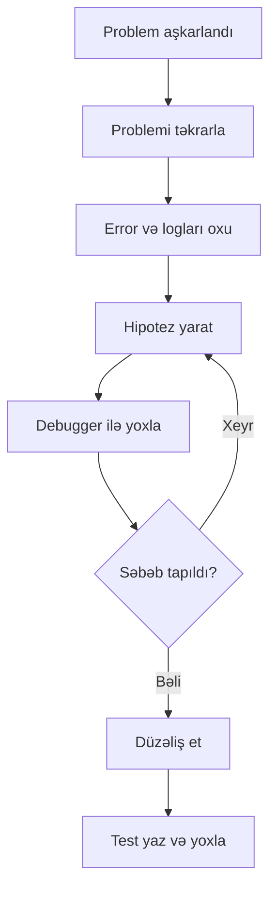

Öyrən:

- Console Debugging
- Breakpoints
- Step Into
- Step Over
- Step Out
- Variable Inspection
- Stack Trace
- Network Inspection
- Memory Profiling

---

# 08 —  Git və GitHub

`VERSION CONTROL` · `COLLABORATION`

## 8.1. Git nədir?

Git layihədəki dəyişikliklərin tarixçəsini saxlayan paylanmış versiya idarəetmə sistemidir.

GitHub isə Git repository-lərini saxlamaq, paylaşmaq və komanda ilə işləmək üçün platformadır.

## 8.2. Fundamental anlayışlar

- Repository
- Working Directory
- Staging Area
- Commit
- Branch
- Merge
- Rebase
- Remote
- Clone
- Pull
- Push
- Fetch
- Merge Conflict
- Pull Request
- Code Review
- Tag
- Release
- `.gitignore`

### Əsas əmrlər

```bash
git init
git status
git add .
git commit -m "feat: add authentication"
git branch
git switch -c feature/auth
git fetch
git pull
git push
git log
git diff
```

### Tipik komanda iş prosesi

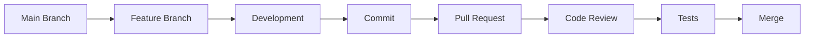

## 8.3. Commit mədəniyyəti

Conventional Commits anlayışını öyrən:

- `feat:` Yeni funksiya
- `fix:` Xəta düzəlişi
- `docs:` Dokumentasiya
- `refactor:` Kod strukturunun yaxşılaşdırılması
- `test:` Test dəyişiklikləri
- `chore:` Texniki dəyişikliklər
- `perf:` Performans təkmilləşdirməsi

> [!WARNING]
> Şifrələri, API açarlarını, access token-ləri və `.env` fayllarındakı məxfi məlumatları repository-yə yükləmə.

### Resurslar

- [Git Documentation](https://git-scm.com/doc)
- [Learn Git Branching](https://learngitbranching.js.org/)
- [GitHub Skills](https://skills.github.com/)
- [Conventional Commits](https://www.conventionalcommits.org/)

---

# 09 —  HTML və Web strukturu

`FRONTEND` · `SEMANTICS` · `ACCESSIBILITY`

## 9.1. HTML nədir?

HyperText Markup Language web səhifəsinin strukturunu və məzmununun mənasını müəyyən edən markup dilidir. Proqramlaşdırma dili deyil.

### Öyrənilməli mövzular

- HTML Document Structure
- Tags və Elements
- Attributes
- Head və Body
- Headings
- Paragraphs
- Links
- Images
- Lists
- Tables
- Forms
- Input Types
- Buttons
- Audio və Video
- SVG
- Semantic HTML
- Metadata
- SEO əsasları
- Accessibility

### Semantic HTML nümunəsi

```html
<header>
    <nav>Navigation</nav>
</header>

<main>
    <section>
        <h1>Məhsullar</h1>
        <article>Məhsul məlumatları</article>
    </section>
</main>

<footer>
    Əlaqə məlumatları
</footer>
```

## 9.2. Accessibility — əlçatanlıq

Web sayt müxtəlif fiziki və texniki imkanlara malik insanlar tərəfindən istifadə edilə bilməlidir.

Öyrən:

- WCAG
- Keyboard Navigation
- Screen Readers
- Alternative Text
- Form Labels
- Focus Management
- Color Contrast
- ARIA
- Semantic Elements

### Praktiki layihələr

- [ ] Şəxsi CV səhifəsi
- [ ] Bloq məqaləsi
- [ ] Qeydiyyat formu
- [ ] Məhsul kataloqu
- [ ] Semantik və əlçatan landing page

---

# 10 —  CSS və UI dizayn

`STYLING` · `LAYOUT` · `RESPONSIVE DESIGN`

## 10.1. CSS nədir?

Cascading Style Sheets HTML elementlərinin vizual görünüşünü, yerləşməsini və davranışının müəyyən hissələrini idarə edir.

## 10.2. Fundamental CSS mövzuları

- Selectors
- Specificity
- Cascade
- Inheritance
- Box Model
- Display
- Position
- Width və Height
- Margin və Padding
- Border
- Overflow
- Z-index
- Colors
- Typography
- CSS Units
- CSS Variables
- Pseudo-classes
- Pseudo-elements
- Flexbox
- Grid
- Media Queries
- Container Queries
- Transitions
- Animations
- Transform
- Responsive Design

## 10.3. UI və UX anlayışları

| Anlayış | Mənası |
|---|---|
| UI | İstifadəçinin gördüyü interfeys |
| UX | İstifadəçinin sistemlə ümumi təcrübəsi |
| Design System | Təkrar istifadə olunan dizayn qaydaları və komponentlər |
| Wireframe | İnterfeysin ilkin struktur eskizi |
| Prototype | İnteraktiv dizayn nümunəsi |
| Design Tokens | Rəng, ölçü və tipoqrafiya kimi dizayn dəyərləri |
| Visual Hierarchy | Elementlərin vizual əhəmiyyət sırası |
| White Space | Elementlər arasındakı boşluq |

Öyrən:

- Rəng nəzəriyyəsi
- Tipoqrafiya
- Alignment
- Spacing
- Consistency
- Mobile First Design
- Dark Mode
- Loading States
- Empty States
- Error States
- Skeleton Loading
- Form Validation States

## 10.4. CSS ekosistemi

Əvvəlcə Vanilla CSS öyrən. Daha sonra:

- Tailwind CSS
- Sass
- CSS Modules
- Component Libraries
- Headless UI
- shadcn/ui

### İnteraktiv resurslar

- [Flexbox Froggy](https://flexboxfroggy.com/)
- [Grid Garden](https://cssgridgarden.com/)
- [CSSBattle](https://cssbattle.dev/)
- [Frontend Mentor](https://www.frontendmentor.io/)
- [Uiverse](https://uiverse.io/)
- [Iconify](https://iconify.design/)
- [Google Fonts](https://fonts.google.com/)
- [Figma](https://www.figma.com/)

---

# 11 —  JavaScript və brauzer

`INTERACTIVITY` · `WEB APIS` · `ASYNC`

## 11.1. JavaScript nədir?

JavaScript web səhifələrinə interaktivlik əlavə edən və müxtəlif runtime mühitlərində işləyə bilən proqramlaşdırma dilidir.

## 11.2. JavaScript Core

- `let`, `const`, `var`
- Primitive Types
- Reference Types
- Type Coercion
- Equality Operators
- Functions
- Arrow Functions
- Closures
- Hoisting
- Scope
- `this`
- Prototypes
- Classes
- Destructuring
- Spread və Rest
- Template Literals
- Optional Chaining
- ES Modules
- Error Handling
- Promises
- Async / Await

## 11.3. Brauzer anlayışları

- DOM
- BOM
- DOM Manipulation
- Events
- Event Bubbling
- Event Capturing
- Event Delegation
- Browser Storage
- Cookies
- LocalStorage
- SessionStorage
- IndexedDB
- Fetch API
- History API
- Web Workers
- Service Workers
- Browser Rendering
- Event Loop
- Call Stack
- Microtask Queue

## 11.4. Asynchronous Programming

```javascript
async function getProducts() {
    try {
        const response = await fetch("/api/products");

        if (!response.ok) {
            throw new Error("Sorğu uğursuz oldu");
        }

        const products = await response.json();
        return products;
    } catch (error) {
        console.error(error);
    }
}
```

Bu kod vasitəsilə API, HTTP request, Promise, async/await, JSON və error handling anlayışlarını öyrənmək mümkündür.

## 11.5. Package Management

- npm
- pnpm
- Yarn
- `package.json`
- Lock Files
- Dependencies
- Dev Dependencies
- Semantic Versioning
- npm Scripts
- Bundlers
- Transpilers
- Vite

### Praktiki layihələr

- [ ] To-do Application
- [ ] Weather Application
- [ ] Expense Tracker
- [ ] Shopping Cart
- [ ] Quiz Application
- [ ] API ilə işləyən məhsul kataloqu
- [ ] LocalStorage istifadə edən Notes App

### Resurslar

- [JavaScript.info](https://javascript.info/)
- [MDN JavaScript](https://developer.mozilla.org/en-US/docs/Web/JavaScript)
- [JavaScript Visualizer](https://www.jsv9000.app/)
- [30 Days of JavaScript](https://github.com/Asabeneh/30-Days-Of-JavaScript)

---

# 12 —  TypeScript

`TYPE SAFETY` · `MAINTAINABILITY`

TypeScript JavaScript-ə statik tip sistemi əlavə edən proqramlaşdırma dilidir. Böyük layihələrdə səhvləri daha erkən müəyyən etməyə və kodun anlaşıqlığını artırmağa kömək edir.

## Öyrənilməli mövzular

- Type Annotations
- Type Inference
- Interfaces
- Type Aliases
- Union Types
- Intersection Types
- Literal Types
- Generics
- Enums
- Utility Types
- Type Guards
- Type Narrowing
- `unknown`
- `never`
- `any`
- Strict Mode
- Declaration Files
- `tsconfig.json`

```typescript
interface Product {
    id: string;
    name: string;
    price: number;
    stock: number;
}

function calculateTotal(
    product: Product,
    quantity: number
): number {
    return product.price * quantity;
}
```

TypeScript runtime zamanı xarici məlumatları avtomatik yoxlamır. API-dən gələn məlumatlar üçün ayrıca runtime validation tələb oluna bilər.

### Resurslar

- [TypeScript Handbook](https://www.typescriptlang.org/docs/handbook/intro.html)
- [TypeScript Playground](https://www.typescriptlang.org/play)
- [Type Challenges](https://github.com/type-challenges/type-challenges)

---

# 13 —  Müasir Frontend Development

`REACT` · `COMPONENTS` · `STATE MANAGEMENT`

## 13.1. Framework və Library nədir?

Library müəyyən funksionallığı təmin edən təkrar istifadə oluna bilən kod toplusudur.

Framework isə tətbiqin strukturunu və inkişaf prosesinin müəyyən qaydalarını formalaşdıran sistemdir.

| Texnologiya | Kateqoriya |
|---|---|
| React | UI Library |
| Vue | Frontend Framework |
| Angular | Frontend Framework |
| Svelte | UI Framework / Compiler |
| Next.js | React Framework |
| Nuxt | Vue Framework |

## 13.2. React Roadmap

- JSX
- Components
- Props
- State
- Events
- Conditional Rendering
- Lists və Keys
- Component Lifecycle
- Hooks
- `useState`
- `useEffect`
- `useRef`
- `useContext`
- `useReducer`
- Custom Hooks
- Controlled Components
- Forms
- Error Boundaries
- Component Composition
- Routing
- Code Splitting
- Lazy Loading

## 13.3. State Management

State tətbiqin müəyyən andakı vəziyyətidir.

Məsələn:

- İstifadəçi daxil olubmu?
- Səbətdə neçə məhsul var?
- Hansı modal açıqdır?
- API sorğusu davam edirmi?

Öyrən:

- Local State
- Global State
- Server State
- URL State
- Form State
- React Context
- Zustand
- Redux Toolkit
- TanStack Query

## 13.4. Rendering strategiyaları

| Strategiya | İzah |
|---|---|
| CSR | Səhifənin əsasən brauzerdə render edilməsi |
| SSR | Səhifənin serverdə render edilməsi |
| SSG | Səhifənin build zamanı yaradılması |
| ISR | Statik səhifələrin müəyyən qaydalarla yenilənməsi |
| Hydration | Serverdən gələn HTML-in interaktivləşdirilməsi |

## 13.5. Frontend Architecture

- Feature-Based Structure
- Reusable Components
- Separation of Concerns
- API Service Layer
- Form Validation
- Authentication State
- Protected Routes
- Error Handling
- Internationalization — i18n
- Responsive Components
- Performance Optimization

### Praktiki layihələr

- [ ] Admin Dashboard
- [ ] E-commerce Frontend
- [ ] CRM Interface
- [ ] Kanban Board
- [ ] Chat Interface
- [ ] Çoxdilli web tətbiqi

### Resurslar

- [React Documentation](https://react.dev/)
- [Next.js Documentation](https://nextjs.org/docs)
- [TanStack](https://tanstack.com/)
- [Frontend Mentor](https://www.frontendmentor.io/)

---

# 14 —  Backend Development

`SERVER` · `BUSINESS LOGIC` · `API`

## 14.1. Backend nədir?

Backend tətbiqin istifadəçiyə birbaşa görünməyən, məlumatların emalını, biznes məntiqini, təhlükəsizliyini və database əlaqələrini idarə edən hissəsidir.

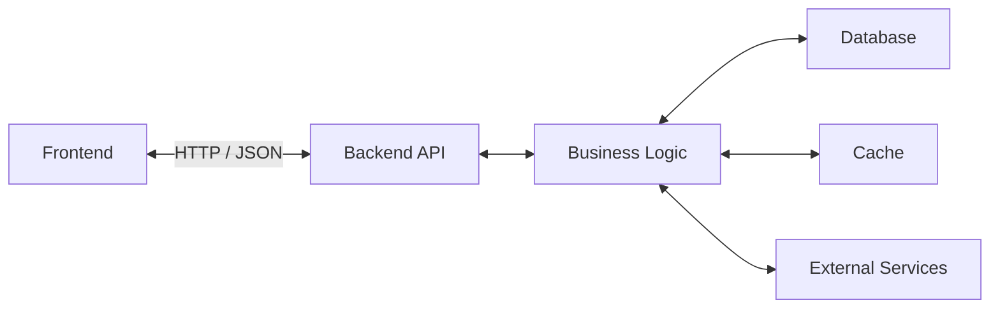

## 14.2. Runtime və Backend texnologiyaları

| Ekosistem | Framework |
|---|---|
| Node.js | Express, Fastify, NestJS |
| Python | Django, FastAPI, Flask |
| C# / .NET | ASP.NET Core |
| Java | Spring Boot |
| PHP | Laravel |
| Go | Gin, Echo |

Tövsiyə olunan başlanğıc: Node.js və Express. Fundamental backend anlayışlarını öyrəndikdən sonra NestJS kimi daha strukturlaşdırılmış framework-ə keçmək olar.

## 14.3. Backend Core

- HTTP Server
- Request və Response
- Routing
- Controllers
- Services
- Middleware
- Business Logic
- Validation
- Error Handling
- Configuration
- Environment Variables
- File Upload
- Logging
- Pagination
- Filtering
- Sorting
- Background Jobs
- Scheduled Tasks
- Email Services
- Webhooks
- Rate Limiting

## 14.4. API nədir?

Application Programming Interface müxtəlif proqramların müəyyən qaydalar vasitəsilə bir-biri ilə əlaqə saxlamasına imkan verir.

### API növləri və əlaqə üsulları

- REST
- GraphQL
- RPC
- gRPC
- WebSocket
- Server-Sent Events
- Webhooks

### REST API nümunəsi

| Method | Endpoint | Funksiya |
|---|---|---|
| GET | `/api/products` | Məhsulları göstər |
| GET | `/api/products/12` | Bir məhsulu göstər |
| POST | `/api/products` | Məhsul yarat |
| PATCH | `/api/products/12` | Məhsulu yenilə |
| DELETE | `/api/products/12` | Məhsulu sil |

## 14.5. API dizayn prinsipləri

- Resource Naming
- HTTP Status Codes
- Consistent Response Format
- Request Validation
- Error Response Structure
- API Versioning
- Pagination
- Idempotency
- Rate Limiting
- OpenAPI
- Swagger
- Backward Compatibility

## 14.6. Authentication və Authorization

Authentication istifadəçinin kimliyini müəyyən edir.

Authorization istifadəçinin hansı əməliyyatları yerinə yetirə biləcəyini müəyyən edir.

Öyrən:

- Password Hashing
- Sessions
- Cookies
- Access Tokens
- Refresh Tokens
- JWT
- OAuth 2.0
- OpenID Connect
- RBAC
- ABAC
- Multi-Factor Authentication
- Passkeys

### Praktiki layihə

İstifadəçi qeydiyyatı, giriş sistemi, məhsul idarəetməsi, rollar, validation və API dokumentasiyası olan REST API hazırla.

### Resurslar

- [Node.js Documentation](https://nodejs.org/docs/latest/api/)
- [Express](https://expressjs.com/)
- [NestJS](https://docs.nestjs.com/)
- [OpenAPI Specification](https://spec.openapis.org/oas/latest.html)
- [Postman Learning Center](https://learning.postman.com/)

---

# 15 —  Database Engineering

`DATA` · `SQL` · `DATA MODELING`

## 15.1. Database nədir?

Database məlumatların strukturlaşdırılmış şəkildə saxlanmasını, axtarılmasını, dəyişdirilməsini və idarə edilməsini təmin edən məlumat sistemidir.

DBMS isə həmin verilənlər bazasını idarə edən proqram təminatıdır.

## 15.2. Database növləri

| Kateqoriya | Nümunə |
|---|---|
| Relational | PostgreSQL, MySQL, SQL Server |
| Document | MongoDB |
| Key-Value | Redis |
| Graph | Neo4j |
| Embedded | SQLite |
| Time Series | InfluxDB |
| Analytical | ClickHouse |
| Vector Search | pgvector, Qdrant |

## 15.3. Relational Database

- Table
- Row
- Column
- Schema
- Primary Key
- Foreign Key
- Unique Constraint
- Not Null
- Check Constraint
- Default Value
- Relationships
- Index
- View
- Stored Procedure
- Trigger
- Transaction

## 15.4. SQL

```sql
SELECT
    products.name,
    products.price,
    categories.name AS category
FROM products
JOIN categories
    ON products.category_id = categories.id
WHERE products.price > 100
ORDER BY products.price DESC;
```

Öyrən:

- SELECT
- INSERT
- UPDATE
- DELETE
- CREATE
- ALTER
- DROP
- WHERE
- GROUP BY
- HAVING
- ORDER BY
- INNER JOIN
- LEFT JOIN
- Subqueries
- Common Table Expressions
- Window Functions
- Aggregate Functions

## 15.5. Database Design

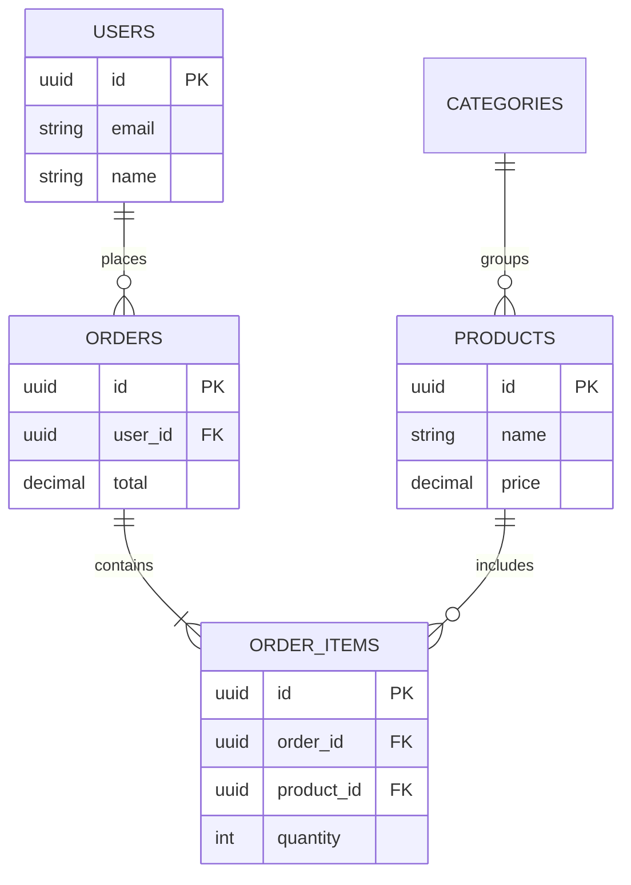

Öyrənilməli anlayışlar:

- One-to-One
- One-to-Many
- Many-to-Many
- Normalization
- Denormalization
- Referential Integrity
- Entity Relationship Diagram
- Database Migration
- Database Seeding

## 15.6. Advanced Database

- ACID
- Atomicity
- Consistency
- Isolation
- Durability
- Transaction Isolation Levels
- Locks
- Deadlocks
- Race Conditions
- Query Optimization
- Execution Plans
- Indexing
- Connection Pooling
- Replication
- Partitioning
- Sharding
- Backup
- Point-in-Time Recovery

## 15.7. ORM nədir?

Object-Relational Mapping proqramlaşdırma dilindəki obyektlərlə relational database arasında əlaqə yaratmağa kömək edir.

Nümunələr:

- Prisma
- Drizzle
- TypeORM
- Sequelize
- Entity Framework Core
- Hibernate

> [!IMPORTANT]
> ORM öyrənməzdən əvvəl SQL öyrən. ORM database anlayışlarının əvəzi deyil.

### Resurslar

- [SQLBolt](https://sqlbolt.com/)
- [PostgreSQL Documentation](https://www.postgresql.org/docs/)
- [SQLZoo](https://sqlzoo.net/)
- [Database Design — dbdiagram.io](https://dbdiagram.io/)
- [Use The Index, Luke](https://use-the-index-luke.com/)

---

# 16 —  Software Architecture

`SYSTEM DESIGN` · `CLEAN CODE` · `ENGINEERING`

## 16.1. Arxitektura nədir?

Software Architecture sistemin əsas komponentlərinin, onların məsuliyyətlərinin, əlaqələrinin və mühüm texniki qərarlarının strukturudur.

## 16.2. Fundamental mühəndislik prinsipləri

| Prinsip | Mənası |
|---|---|
| DRY | Lazımsız təkrarlardan qaçmaq |
| KISS | Həlli mümkün qədər sadə saxlamaq |
| YAGNI | Ehtiyac olmayan funksiyanı əvvəlcədən hazırlamamaq |
| SOLID | Obyekt yönümlü dizayn prinsipləri |
| Separation of Concerns | Fərqli məsuliyyətləri ayırmaq |
| Single Responsibility | Komponentin aydın məsuliyyətə malik olması |
| Loose Coupling | Komponentlər arasında asılılığı azaltmaq |
| High Cohesion | Əlaqəli funksiyaları bir yerdə saxlamaq |

## 16.3. Arxitektura modelləri

- Monolithic Architecture
- Modular Monolith
- Layered Architecture
- MVC
- Clean Architecture
- Hexagonal Architecture
- Microservices
- Event-Driven Architecture
- Serverless Architecture

Başlanğıcda yaxşı strukturlaşdırılmış modular monolith hazırlamaq, səbəbsiz yerə microservices istifadə etməkdən daha məqsədəuyğundur.

## 16.4. Design Patterns

- Factory
- Strategy
- Adapter
- Observer
- Repository
- Dependency Injection
- Facade
- Decorator
- Builder
- Singleton və onun məhdudiyyətləri

## 16.5. System Design anlayışları

- Scalability
- Vertical Scaling
- Horizontal Scaling
- Availability
- Reliability
- Fault Tolerance
- Load Balancing
- Caching
- Message Queues
- Eventual Consistency
- Distributed Systems
- CAP Theorem
- Single Point of Failure
- Backpressure
- Retry
- Timeout
- Circuit Breaker
- Idempotency

### Tipik production sistemi

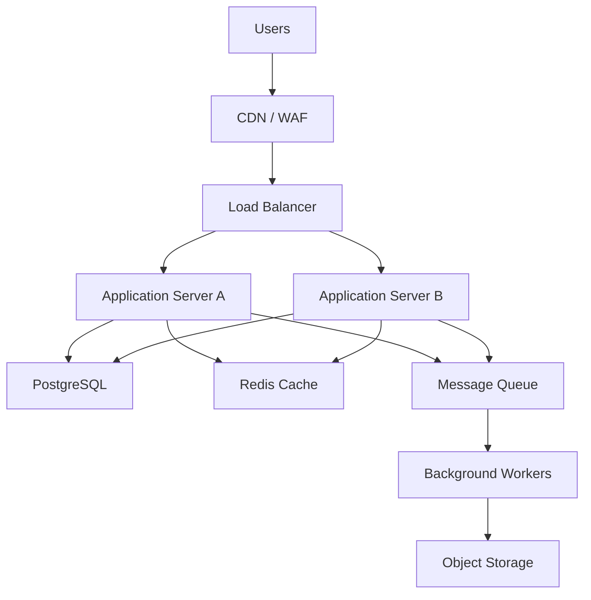

## 16.6. Texniki qərar vermək

Hər texnologiya seçimindən əvvəl soruş:

- Hansı problemi həll edir?
- Daha sadə alternativ varmı?
- Performans tələbi nədir?
- Təhlükəsizlik riski nədir?
- İnkişaf və infrastruktur xərci nədir?
- Komanda bu texnologiyanı idarə edə bilərmi?
- Gələcəkdə dəyişdirilməsi nə qədər çətin olacaq?

### Resurslar

- [System Design Primer](https://github.com/donnemartin/system-design-primer)
- [Refactoring Guru](https://refactoring.guru/)
- [Martin Fowler](https://martinfowler.com/)
- [Architecture of Open Source Applications](https://aosabook.org/en/)

---

# 17 —  Cybersecurity

`SECURITY` · `PRIVACY` · `SECURE DEVELOPMENT`

## 17.1. Cybersecurity nədir?

Cybersecurity kompüter sistemlərinin, şəbəkələrin, proqramların və məlumatların icazəsiz girişdən, dəyişdirilmədən, məhv edilmədən və digər təhlükələrdən qorunmasıdır.

## 17.2. CIA Triad

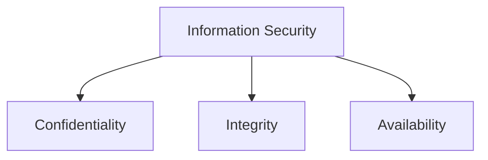

| Prinsip | Mənası |
|---|---|
| Confidentiality | Məlumata yalnız icazəli şəxslərin çıxışı |
| Integrity | Məlumatın düzgünlüyünün qorunması |
| Availability | Sistemin lazım olduqda əlçatan olması |

## 17.3. Təhlükəsizlik terminologiyası

- Asset
- Threat
- Vulnerability
- Risk
- Exploit
- Attack Surface
- Threat Modeling
- Security Controls
- Defense in Depth
- Least Privilege
- Zero Trust
- Security Incident
- Data Breach

## 17.4. Kriptoqrafiya əsasları

| Anlayış | Məqsəd |
|---|---|
| Hashing | Məlumatın birtərəfli xülasəsini yaratmaq |
| Encryption | Məlumatı açar vasitəsilə şifrələmək |
| Encoding | Məlumatın təqdimat formasını dəyişmək |
| Digital Signature | Mənbə və bütövlüyü təsdiqləmək |
| Salt | Password hashing prosesini gücləndirmək |
| Symmetric Encryption | Eyni məxfi açardan istifadə |
| Asymmetric Encryption | Public və Private Key istifadəsi |
| TLS | Şəbəkə əlaqəsinin qorunması |

Base64 şifrələmə deyil. Hashing və encryption eyni anlayış deyil.

## 17.5. Web təhlükəsizlik riskləri

- SQL Injection
- Cross-Site Scripting — XSS
- Cross-Site Request Forgery — CSRF
- Broken Access Control
- Insecure Direct Object Reference — IDOR
- Server-Side Request Forgery — SSRF
- Path Traversal
- Command Injection
- Security Misconfiguration
- Insecure File Upload
- Session Hijacking
- Brute Force
- Supply Chain Attacks
- Denial of Service
- Sensitive Data Exposure

## 17.6. Təhlükəsiz proqramlaşdırma checklist-i

- [ ] Bütün xarici məlumatları serverdə validate et.
- [ ] SQL sorğularında parameterized queries istifadə et.
- [ ] Şifrələri açıq mətn formasında saxlama.
- [ ] Password hashing üçün Argon2id və ya uyğun alternativ istifadə et.
- [ ] HTTPS istifadə et.
- [ ] Backend səviyyəsində authorization yoxlamaları apar.
- [ ] Secure, HttpOnly və uyğun SameSite cookie parametrlərini tətbiq et.
- [ ] Məxfi məlumatları loglara yazma.
- [ ] Rate Limiting tətbiq et.
- [ ] Dependency-ləri mütəmadi yoxla.
- [ ] API açarlarını frontend-ə yerləşdirmə.
- [ ] Database backup-larını qoru.
- [ ] Content Security Policy anlayışını öyrən.
- [ ] CORS qaydalarını düzgün konfiqurasiya et.
- [ ] Audit log sistemi yarat.
- [ ] Secret Management tətbiq et.
- [ ] Təhlükəsizlik testləri yaz.

## 17.7. Cybersecurity istiqamətləri

- Application Security — AppSec
- Network Security
- Cloud Security
- Security Operations — SOC
- Digital Forensics
- Incident Response
- Penetration Testing
- DevSecOps
- Identity and Access Management — IAM

> [!WARNING]
> Təhlükəsizlik testlərini yalnız öz sistemlərində, xüsusi təlim laboratoriyalarında və ya açıq şəkildə icazə verilmiş sistemlərdə həyata keçir.

### Praktiki öyrənmə platformaları

- [OWASP](https://owasp.org/)
- [OWASP Cheat Sheet Series](https://cheatsheetseries.owasp.org/)
- [PortSwigger Web Security Academy](https://portswigger.net/web-security)
- [TryHackMe](https://tryhackme.com/)
- [picoCTF](https://picoctf.org/)
- [OWASP Juice Shop](https://owasp.org/www-project-juice-shop/)

---

# 18 —  Testing və Software Quality

`QUALITY ASSURANCE` · `AUTOMATED TESTING`

## 18.1. Testing nədir?

Testing proqramın gözlənilən formada işlədiyini yoxlamaq, xətaları müəyyən etmək və dəyişikliklərin mövcud funksiyaları pozmadığından əmin olmaq üçün həyata keçirilən prosesdir.

## 18.2. Test növləri

| Test | Məqsəd |
|---|---|
| Unit Test | Kiçik kod vahidini yoxlamaq |
| Integration Test | Komponentlər arasındakı əlaqəni yoxlamaq |
| End-to-End Test | Tam istifadəçi ssenarisini yoxlamaq |
| Regression Test | Köhnə funksiyaların pozulmasını müəyyən etmək |
| Smoke Test | Əsas funksiyaların işləməsini yoxlamaq |
| Load Test | Gözlənilən yük altında davranışı yoxlamaq |
| Stress Test | Sistemin limitlərini araşdırmaq |
| Security Test | Təhlükəsizlik problemlərini müəyyən etmək |

## 18.3. Testing anlayışları

- Test Case
- Test Suite
- Assertion
- Mock
- Stub
- Fixture
- Test Coverage
- Edge Cases
- Happy Path
- TDD
- BDD

### Test nümunəsi

```javascript
import { expect, test } from "vitest";

test("Məhsulun ümumi qiymətini hesablayır", () => {
    expect(25 * 4).toBe(100);
});
```

## 18.4. Alətlər

- Vitest
- Jest
- Playwright
- Cypress
- Testing Library
- k6
- ESLint
- SonarQube

## 18.5. Kod keyfiyyəti

- Aydın dəyişən adları
- Kiçik və məqsədli funksiyalar
- Lazımsız mürəkkəbliyin azaldılması
- Refactoring
- Code Review
- Dokumentasiya
- Static Analysis
- Technical Debt

### Resurslar

- [Vitest](https://vitest.dev/)
- [Playwright](https://playwright.dev/)
- [Testing Library](https://testing-library.com/)
- [Testing JavaScript](https://testingjavascript.com/)

---

# 19 —  Docker və Containerization

`CONTAINERS` · `INFRASTRUCTURE` · `DEPLOYMENT`

## 19.1. Docker nədir?

Docker tətbiqlərin və onların asılılıqlarının izolyasiya edilmiş container mühitində paketlənməsinə və işlədilməsinə imkan verən platformadır.

### Docker hansı problemi həll edir?

Developer kompüterində işləyən proqramın başqa kompüterdə fərqli dependency və konfiqurasiya səbəbindən işləməməsi problemini azaltmağa kömək edir.

## 19.2. Virtual Machine və Container

| Virtual Machine | Container |
|---|---|
| Ayrı guest əməliyyat sistemi | Adətən host kernel-i paylaşır |
| Daha çox resurs tələb edə bilər | Adətən daha yüngüldür |
| Daha gec başlaya bilər | Adətən daha sürətli başlayır |
| Hardware virtualization | OS-level isolation |

## 19.3. Docker anlayışları

- Docker Engine
- Image
- Container
- Dockerfile
- Registry
- Docker Hub
- Layers
- Volumes
- Bind Mounts
- Networks
- Port Mapping
- Environment Variables
- Docker Compose
- Health Checks
- Multi-stage Builds

### Sadə Dockerfile

```dockerfile
FROM node:22-alpine

WORKDIR /app

COPY package*.json ./
RUN npm ci

COPY . .

EXPOSE 3000

CMD ["npm", "start"]
```

Bu, öyrənmə məqsədli sadə nümunədir. Production üçün non-root user, təhlükəsizlik yoxlamaları və uyğun build strategiyası əlavə edilməlidir.

## 19.4. Docker Compose

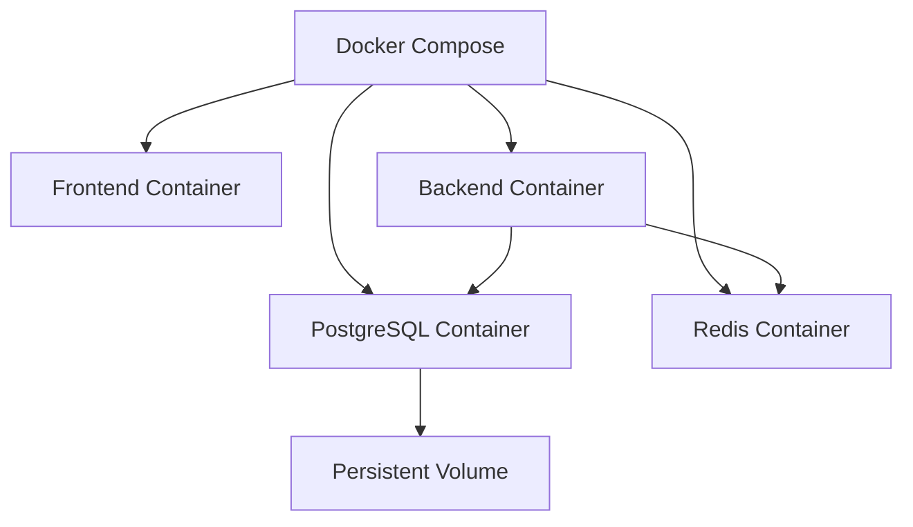

### Praktiki tapşırıq

- [ ] Docker quraşdır.
- [ ] Nginx container işə sal.
- [ ] Node.js tətbiqi üçün Dockerfile yaz.
- [ ] PostgreSQL container yarat.
- [ ] Docker Compose ilə bütün sistemi işə sal.
- [ ] Volume və Network anlayışlarını tətbiq et.
- [ ] Container loglarını analiz et.

### Resurslar

- [Docker Get Started](https://docs.docker.com/get-started/)
- [Docker Curriculum](https://docker-curriculum.com/)

---

# 20 —  DevOps və Cloud Computing

`AUTOMATION` · `CI/CD` · `OPERATIONS`

## 20.1. DevOps nədir?

DevOps development və operations proseslərinin əməkdaşlıq, avtomatlaşdırma və davamlı təkmilləşdirmə prinsipləri ilə birləşdirilməsidir.

DevOps sadəcə Docker və ya Kubernetes bilmək deyil. Bu, proqramın hazırlanmasından production mühitində idarə edilməsinə qədər olan prosesin təkmilləşdirilməsidir.

## 20.2. DevOps Lifecycle

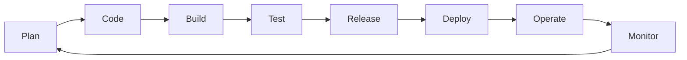

## 20.3. CI/CD

Continuous Integration — kod dəyişikliklərinin davamlı inteqrasiyası və avtomatik yoxlanması.

Continuous Delivery — proqramın təhlükəsiz şəkildə release edilməyə hazır saxlanılması.

Continuous Deployment — uğurlu yoxlamalardan keçən dəyişikliklərin avtomatik production mühitinə yerləşdirilməsi.

### Tipik pipeline

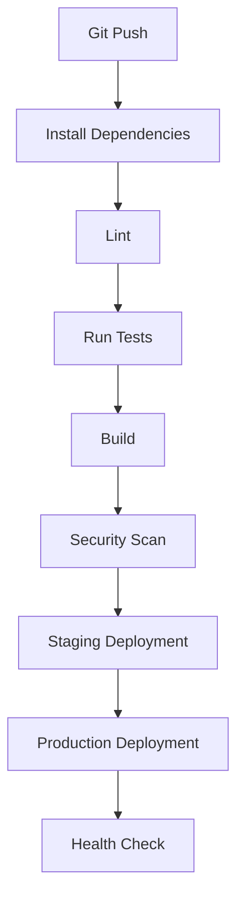

## 20.4. DevOps alətləri

| Alət | Məqsəd |
|---|---|
| GitHub Actions | CI/CD |
| GitLab CI | CI/CD |
| Jenkins | Automation Server |
| Docker | Containerization |
| Kubernetes | Container Orchestration |
| Terraform / OpenTofu | Infrastructure as Code |
| Ansible | Configuration Management |
| Nginx | Web Server və Reverse Proxy |
| Caddy | Web Server və Reverse Proxy |
| Prometheus | Metrics |
| Grafana | Monitoring və Visualization |

## 20.5. Cloud Computing nədir?

Cloud Computing server, database, storage və digər hesablama resurslarının şəbəkə vasitəsilə xidmət kimi təqdim edilməsidir.

### Cloud modelləri

| Model | İzah |
|---|---|
| IaaS | İnfrastruktur xidmət kimi |
| PaaS | Platforma xidmət kimi |
| SaaS | Proqram təminatı xidmət kimi |
| FaaS | Funksiya xidmət kimi |

### Cloud platformaları

- Amazon Web Services
- Microsoft Azure
- Google Cloud
- Cloudflare
- DigitalOcean
- Hetzner
- Vercel
- Railway
- Render

## 20.6. Cloud fundamental anlayışları

- Virtual Private Server — VPS
- Virtual Private Cloud — VPC
- Regions və Availability Zones
- Object Storage
- Block Storage
- Managed Database
- Load Balancer
- Auto Scaling
- IAM
- Secrets Management
- Serverless
- Infrastructure as Code
- Cloud Cost Management

## 20.7. Deployment strategiyaları

- Rolling Deployment
- Blue-Green Deployment
- Canary Deployment
- Recreate Deployment
- Rollback
- Feature Flags

### Praktiki layihə

Full Stack tətbiqini VPS üzərində Docker Compose, PostgreSQL, Reverse Proxy, HTTPS və avtomatik deployment ilə yayımla.

### Resurslar

- [GitHub Actions Documentation](https://docs.github.com/en/actions)
- [Kubernetes Basics](https://kubernetes.io/docs/tutorials/kubernetes-basics/)
- [Terraform Tutorials](https://developer.hashicorp.com/terraform/tutorials)
- [AWS Skill Builder](https://skillbuilder.aws/)
- [Google Cloud Skills Boost](https://www.cloudskillsboost.google/)

---

# 21 —  SRE və Observability

`RELIABILITY` · `MONITORING` · `PRODUCTION`

## 21.1. SRE nədir?

Site Reliability Engineering sistemlərin etibarlılığını, əlçatanlığını və əməliyyat proseslərini software engineering metodları ilə idarə edən mühəndislik istiqamətidir.

### DevOps və SRE fərqi

| DevOps | SRE |
|---|---|
| Əməkdaşlıq və delivery mədəniyyəti | Etibarlılığın mühəndisliklə idarə edilməsi |
| Avtomatlaşdırma | Reliability Automation |
| Deployment prosesləri | Production davranışı |
| Davamlı inkişaf | Ölçülə bilən xidmət hədəfləri |

Bu iki istiqamət bir-birini tamamlayır.

## 21.2. SLI, SLO və SLA

- **SLI:** Xidmətin ölçülən göstəricisi.
- **SLO:** Həmin göstərici üçün müəyyən edilən hədəf.
- **SLA:** Xidmət səviyyəsi ilə bağlı razılaşma.

Məsələn, sistemin aylıq əlçatanlıq hədəfi 99.9% ola bilər.

| Availability | 30 günlük ayda təxmini əlçatmazlıq büdcəsi |
|---|---|
| 99% | 7 saat 12 dəqiqə |
| 99.9% | 43 dəqiqə 12 saniyə |
| 99.99% | 4 dəqiqə 19 saniyə |
| 99.999% | 26 saniyə |

## 21.3. Observability nədir?

Sistemin xarici siqnallarından onun daxili vəziyyətini anlamaq qabiliyyətidir.

### Üç əsas telemetriya növü

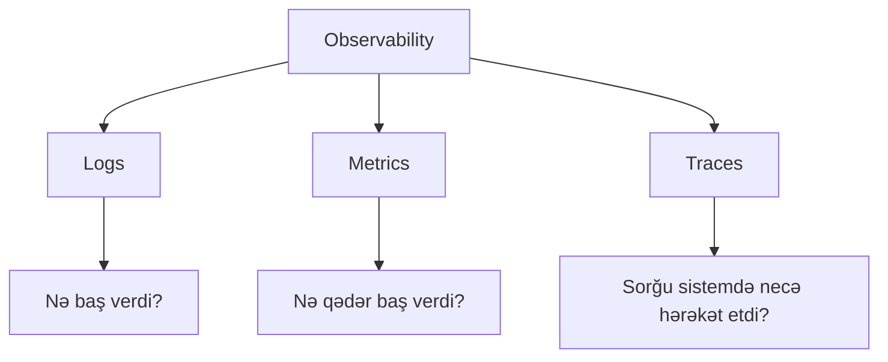

## 21.4. Golden Signals

- Latency
- Traffic
- Errors
- Saturation

## 21.5. Incident Management

- Alerting
- On-call
- Incident Response
- Runbook
- Root Cause Analysis
- Postmortem
- Blameless Culture
- Disaster Recovery
- Error Budget
- RTO
- RPO

## 21.6. Observability alətləri

- Prometheus
- Grafana
- OpenTelemetry
- Loki
- Jaeger
- Sentry
- Uptime Kuma

### Resurslar

- [Google SRE Books](https://sre.google/books/)
- [OpenTelemetry](https://opentelemetry.io/)
- [Prometheus Documentation](https://prometheus.io/docs/)
- [Grafana Tutorials](https://grafana.com/tutorials/)

---

# 22 —  Süni intellekt və müasir proqramçı

`AI-ASSISTED DEVELOPMENT` · `CRITICAL THINKING`

## 22.1. AI proqramçını necə dəyişdirir?

Süni intellekt kod yazma, dokumentasiya, test hazırlama, araşdırma və debugging proseslərini sürətləndirə bilər.

Lakin proqramçı sistemin necə işlədiyini anlamalı və AI tərəfindən yaradılan nəticələrə görə məsuliyyət daşımalıdır.

## 22.2. Öyrənilməli AI anlayışları

- Artificial Intelligence
- Machine Learning
- Deep Learning
- Large Language Models
- Tokens
- Context Window
- Prompt Engineering
- Hallucination
- Embeddings
- Vector Database
- RAG
- Tool Calling
- Structured Output
- AI Agents
- MCP
- Model Evaluation
- AI Security

## 22.3. AI-dan düzgün istifadə

- AI-dan mövzunu izah etməsini istə.
- Hazır həll əvəzinə istiqamət və ipucu al.
- Kodun hər hissəsinin məqsədini anla.
- Yaradılmış kodu test et.
- Təhlükəsizlik risklərini yoxla.
- Kitabxana və API-ləri rəsmi dokumentasiya ilə müqayisə et.
- Məxfi məlumatları icazəsiz AI sistemlərinə göndərmə.
- AI-nın təklif etdiyi arxitekturanı avtomatik qəbul etmə.
- AI olmadan da sadə layihə hazırlamağı bacar.

## 22.4. AI alətləri

- ChatGPT
- Claude
- Gemini
- GitHub Copilot
- Cursor
- Codex

> [!IMPORTANT]
> AI ilə 1 000 sətir kod hazırlamaq, həmin kodun necə işlədiyini anlamırsansa, 1 000 sətirlik texniki məsuliyyət yaratmaq deməkdir.

---

# 23 —  12–18 aylıq tədris planı

Bu müddətlər gündəlik 2–4 saat çalışma üçün təxmini planlaşdırmadır. Hər insanın öyrənmə sürəti fərqlidir.

| Mərhələ | Müddət | Mövzular |
|---|---|---|
| 01 | 1-ci ay | Düşüncə, etika, Computer Science |
| 02 | 2-ci ay | Linux, Terminal, Networking, Git |
| 03 | 3–4-cü ay | Proqramlaşdırma, JavaScript, alqoritmlər |
| 04 | 5-ci ay | HTML, CSS, UI/UX |
| 05 | 6-cı ay | Advanced JavaScript, TypeScript |
| 06 | 7–8-ci ay | React, Frontend Architecture |
| 07 | 9–10-cu ay | Backend, API, Authentication |
| 08 | 11-ci ay | SQL, PostgreSQL, Database Design |
| 09 | 12-ci ay | Full Stack layihə |
| 10 | 13-cü ay | Cybersecurity, Testing |
| 11 | 14-cü ay | Docker, DevOps, Deployment |
| 12 | 15-ci ay | System Design, SRE |
| 13 | 16–18-ci ay | Production layihələri, portfolio, karyera |

Təhlükəsizlik, test, Git və dokumentasiya son mərhələyə saxlanılmamalıdır. İlk layihədən etibarən tətbiq edilməli, sonrakı aylarda isə daha dərindən öyrənilməlidir.

## Gündəlik çalışma modeli

| Fəaliyyət | Müddət |
|---|---|
| Nəzəriyyə və dokumentasiya | 30 dəqiqə |
| Praktiki kodlaşdırma | 90 dəqiqə |
| Problem həlli | 30 dəqiqə |
| Debugging və araşdırma | 20 dəqiqə |
| Qeydlər və təkrar | 10 dəqiqə |

## Həftəlik çalışma modeli

| Gün | Fəaliyyət |
|---|---|
| Bazar ertəsi | Yeni mövzu |
| Çərşənbə axşamı | Praktiki tapşırıqlar |
| Çərşənbə | Yeni mövzu və araşdırma |
| Cümə axşamı | Layihə inkişafı |
| Cümə | Layihə inkişafı |
| Şənbə | Test, refactoring və təkrar |
| Bazar | İstirahət və həftəlik analiz |

---

# 24 —  Praktiki layihələr xəritəsi

## LEVEL 01 — Beginner

- Şəxsi portfolio səhifəsi
- Kalkulyator
- To-do List
- Quiz Application
- Responsive Landing Page
- Weather Application

**Məqsəd:** HTML, CSS, JavaScript, DOM və fundamental məntiq.

## LEVEL 02 — Junior Frontend

- E-commerce Frontend
- Admin Dashboard
- Expense Tracker
- Kanban Board
- Movie Search Application

**Məqsəd:** React, TypeScript, API, State Management və UI Architecture.

## LEVEL 03 — Junior Full Stack

- Blog Management System
- Authentication System
- Inventory Management System
- Appointment Booking System
- Customer Relationship Management — CRM

**Məqsəd:** Backend, Database, API, Authentication və Authorization.

## LEVEL 04 — Production-Oriented Developer

- Çoxistifadəçili e-commerce platforması
- POS və anbar idarəetmə sistemi
- Real-time Chat Application
- SaaS platforması
- Multi-tenant CRM

**Məqsəd:** Arxitektura, təhlükəsizlik, transaction, caching, background jobs, deployment və monitoring.

## Final Project — Professional SaaS Platform

Son layihədə aşağıdakı xüsusiyyətlər olmalıdır:

- [ ] İstifadəçi qeydiyyatı
- [ ] Authentication
- [ ] Role-Based Access Control
- [ ] Multi-tenancy və tenant isolation
- [ ] Admin Dashboard
- [ ] PostgreSQL Database
- [ ] REST API
- [ ] API Documentation
- [ ] Search, Filtering və Pagination
- [ ] File Upload
- [ ] Email Notifications
- [ ] Background Jobs
- [ ] Audit Logs
- [ ] Redis Cache
- [ ] Unit Tests
- [ ] Integration Tests
- [ ] End-to-End Tests
- [ ] Docker
- [ ] CI/CD
- [ ] HTTPS
- [ ] Monitoring
- [ ] Error Tracking
- [ ] Database Backup
- [ ] Responsive Design
- [ ] Accessibility
- [ ] Internationalization
- [ ] Professional README

---

# 25 —  Öyrənmə platformaları

## Kompleks proqramlaşdırma kursları

| Platforma | İstiqamət |
|---|---|
| [Roadmap.sh](https://roadmap.sh/) | İnteraktiv developer roadmap-ları |
| [CS50](https://cs50.harvard.edu/x/) | Computer Science |
| [freeCodeCamp](https://www.freecodecamp.org/) | Full Stack və praktiki kurslar |
| [The Odin Project](https://www.theodinproject.com/) | Layihə əsaslı Full Stack |
| [Full Stack Open](https://fullstackopen.com/en/) | Müasir Full Stack Development |
| [MDN](https://developer.mozilla.org/) | Web standartları |
| [Web.dev](https://web.dev/) | Web Performance və best practices |
| [OSSU](https://github.com/ossu/computer-science) | Computer Science tədris proqramı |
| [MIT OpenCourseWare](https://ocw.mit.edu/) | Akademik kurslar |
| [Exercism](https://exercism.org/) | Proqramlaşdırma praktikası |
| [Frontend Masters](https://frontendmasters.com/) | Peşəkar texniki kurslar |
| [Scrimba](https://scrimba.com/) | İnteraktiv Frontend tədrisi |

Bəzi platformalarda ödənişli kurslar və ya əlavə funksiyalar mövcuddur.

## Maraqlı interaktiv saytlar

| Sayt | Nə üçün maraqlıdır? |
|---|---|
| [VisuAlgo](https://visualgo.net/) | Alqoritmlərin vizual izahı |
| [Python Tutor](https://pythontutor.com/) | Kodun addım-addım icrası |
| [Regex101](https://regex101.com/) | Regular Expression testləri |
| [ExplainShell](https://explainshell.com/) | Terminal əmrlərinin izahı |
| [Learn Git Branching](https://learngitbranching.js.org/) | Vizual Git simulyasiyası |
| [Flexbox Froggy](https://flexboxfroggy.com/) | Oyunla CSS öyrənmək |
| [CSSBattle](https://cssbattle.dev/) | CSS yarışları |
| [Can I Use](https://caniuse.com/) | Browser compatibility |
| [Bundlephobia](https://bundlephobia.com/) | npm paketlərinin ölçüsü |
| [Excalidraw](https://excalidraw.com/) | Arxitektura eskizləri |
| [Mermaid Live](https://mermaid.live/) | Kod vasitəsilə diaqram yaratmaq |
| [JSONPlaceholder](https://jsonplaceholder.typicode.com/) | Test API |
| [DevDocs](https://devdocs.io/) | Texniki dokumentasiyalar |
| [Devhints](https://devhints.io/) | Texniki cheat sheet-lər |
| [Carbon](https://carbon.now.sh/) | Vizual kod təqdimatı |
| [Iconify](https://iconify.design/) | Geniş ikon kitabxanası |
| [Hacker News](https://news.ycombinator.com/) | Texnologiya və mühəndislik müzakirələri |

---

# 26 —  Tövsiyə olunan YouTube kanalları

## Computer Science və fundamental anlayışlar

| Kanal | Mövzu |
|---|---|
| [CS50](https://www.youtube.com/@cs50) | Computer Science |
| [Computerphile](https://www.youtube.com/@Computerphile) | Kompüter elmləri |
| [CrashCourse](https://www.youtube.com/@crashcourse) | Fundamental elmlər |
| [Ben Eater](https://www.youtube.com/@BenEater) | Hardware və kompüter arxitekturası |
| [3Blue1Brown](https://www.youtube.com/@3blue1brown) | Vizual riyaziyyat |

## Web Development

| Kanal | Mövzu |
|---|---|
| [freeCodeCamp](https://www.youtube.com/@freecodecamp) | Kompleks kurslar |
| [Fireship](https://www.youtube.com/@Fireship) | Texnologiyaların qısa izahları |
| [Traversy Media](https://www.youtube.com/@TraversyMedia) | Full Stack |
| [The Net Ninja](https://www.youtube.com/@NetNinja) | Frontend və Backend |
| [Web Dev Simplified](https://www.youtube.com/@WebDevSimplified) | JavaScript və React |
| [Kevin Powell](https://www.youtube.com/@KevinPowell) | CSS |
| [Theo](https://www.youtube.com/@t3dotgg) | Web ekosistemi və mühəndislik |
| [Codevolution](https://www.youtube.com/@Codevolution) | React və JavaScript |

## Backend və System Design

| Kanal | Mövzu |
|---|---|
| [ByteByteGo](https://www.youtube.com/@ByteByteGo) | System Design |
| [Hussein Nasser](https://www.youtube.com/@hnasr) | Backend və Networking |
| [ArjanCodes](https://www.youtube.com/@ArjanCodes) | Software Architecture |
| [Continuous Delivery](https://www.youtube.com/@ContinuousDelivery) | Software Engineering |
| [GOTO Conferences](https://www.youtube.com/@GOTO-) | Peşəkar mühəndislik çıxışları |

## Linux, DevOps və Cybersecurity

| Kanal | Mövzu |
|---|---|
| [TechWorld with Nana](https://www.youtube.com/@TechWorldwithNana) | DevOps |
| [Learn Linux TV](https://www.youtube.com/@LearnLinuxTV) | Linux |
| [NetworkChuck](https://www.youtube.com/@NetworkChuck) | Networking və Linux |
| [John Hammond](https://www.youtube.com/@_JohnHammond) | Cybersecurity |
| [LiveOverflow](https://www.youtube.com/@LiveOverflow) | Security Research |
| [Computerphile](https://www.youtube.com/@Computerphile) | Security və kriptoqrafiya |

## Türk dilində resurslar

- [Yazılım Bilimi](https://www.youtube.com/@YazilimBilimi)
- [BTK Akademi](https://www.btkakademi.gov.tr/)
- [Patika.dev](https://www.patika.dev/)
- [Kodluyoruz](https://kodluyoruz.org/)

---

# 27 —  Kitablar və mühəndislik ədəbiyyatı

| Kitab | Mövzu |
|---|---|
| The Pragmatic Programmer | Proqramçı düşüncəsi |
| Code — Charles Petzold | Kompüterlərin iş prinsipi |
| Grokking Algorithms | Alqoritmlər |
| Eloquent JavaScript | JavaScript |
| A Philosophy of Software Design | Kod və arxitektura |
| Refactoring — Martin Fowler | Kodun təkmilləşdirilməsi |
| Designing Data-Intensive Applications | Database və distributed systems |
| The Linux Command Line | Linux |
| Site Reliability Engineering | SRE |
| Accelerate | Software Delivery və DevOps |
| The Phoenix Project | DevOps mədəniyyəti |
| Don't Make Me Think | UX |
| The Staff Engineer's Path | Mühəndislik və karyera inkişafı |

Kitablardakı bütün prinsipləri mütləq qayda kimi deyil, kontekstə uyğun qiymətləndirmək lazımdır.

---

# 28 —  Karyera və peşəkar inkişaf

## 28.1. Proqramçı səviyyələri

| Səviyyə | Ümumi bacarıq |
|---|---|
| Intern | Fundamental biliklər və öyrənmə |
| Junior | Məhdud tapşırıqları dəstəklə həll etmək |
| Middle | Funksionallığı müstəqil hazırlamaq |
| Senior | Mürəkkəb texniki problemləri və qərarları idarə etmək |
| Staff | Komandalararası texniki istiqamət yaratmaq |
| Principal | Təşkilat səviyyəsində mühəndislik qərarları |
| Tech Lead | Komandanın texniki istiqamətini idarə etmək |

Vəzifə adları şirkətlər arasında fərqlənir. Senior olmaq yalnız müəyyən sayda texnologiya bilmək və ya müəyyən müddət işləmək demək deyil.

## 28.2. Portfolio

Portfolio layihələrində aşağıdakılar olmalıdır:

- Layihənin həll etdiyi problem
- İstifadə olunan texnologiyalar
- Arxitektura diaqramı
- Database ERD
- Quraşdırma təlimatı
- API dokumentasiyası
- Testlər
- Screenshot-lar
- Demo linki
- Texniki qərarların izahı
- Mövcud məhdudiyyətlər

## 28.3. Soft Skills

- Communication
- Teamwork
- Time Management
- Critical Thinking
- Problem Solving
- Technical Writing
- Requirement Analysis
- Feedback
- Conflict Resolution
- Ownership
- Estimation
- Presentation Skills

## 28.4. Layihə idarəetməsi

- Agile
- Scrum
- Kanban
- Sprint
- Backlog
- User Story
- Acceptance Criteria
- Issue Tracking
- Definition of Done
- Retrospective
- Product Requirements Document
- Architecture Decision Record

---

# 29 —  Final Knowledge Checklist

## Fundamental biliklər

- [ ] Kompüterin necə işlədiyini izah edə bilirəm.
- [ ] CPU, RAM və Storage fərqini bilirəm.
- [ ] Compiler və Interpreter anlayışlarını bilirəm.
- [ ] Process və Thread fərqini anlayıram.
- [ ] Linux terminalından istifadə edə bilirəm.
- [ ] İnternetin necə işlədiyini izah edə bilirəm.
- [ ] DNS, HTTP, TCP və TLS anlayışlarını bilirəm.

## Proqramlaşdırma

- [ ] Problemləri alqoritmlərə çevirə bilirəm.
- [ ] Data Structures anlayışlarını bilirəm.
- [ ] Big O Notation anlayıram.
- [ ] JavaScript və TypeScript ilə işləyə bilirəm.
- [ ] Asynchronous Programming anlayıram.
- [ ] Debugging edə bilirəm.
- [ ] Git ilə komanda daxilində işləyə bilirəm.

## Frontend

- [ ] Semantic HTML yaza bilirəm.
- [ ] Responsive CSS hazırlaya bilirəm.
- [ ] Accessibility prinsiplərini bilirəm.
- [ ] React komponentləri hazırlaya bilirəm.
- [ ] State Management anlayıram.
- [ ] API inteqrasiyası edə bilirəm.
- [ ] Frontend performansını analiz edə bilirəm.

## Backend və Database

- [ ] REST API hazırlaya bilirəm.
- [ ] Authentication və Authorization fərqini bilirəm.
- [ ] Business Logic yaza bilirəm.
- [ ] SQL sorğuları hazırlaya bilirəm.
- [ ] Database dizayn edə bilirəm.
- [ ] Transaction və Index anlayışlarını bilirəm.
- [ ] Background Jobs və Cache istifadə edə bilirəm.

## Təhlükəsizlik və keyfiyyət

- [ ] Əsas web təhlükəsizlik risklərini bilirəm.
- [ ] Şifrələri təhlükəsiz saxlamağı bilirəm.
- [ ] İstifadəçi məlumatlarını qorumağı bilirəm.
- [ ] Unit və Integration Test yaza bilirəm.
- [ ] Code Review edə bilirəm.
- [ ] Texniki borcu müəyyən edə bilirəm.

## İnfrastruktur

- [ ] Dockerfile hazırlaya bilirəm.
- [ ] Docker Compose istifadə edə bilirəm.
- [ ] Linux server idarə edə bilirəm.
- [ ] Domain və HTTPS konfiqurasiya edə bilirəm.
- [ ] CI/CD pipeline hazırlaya bilirəm.
- [ ] Backup və Restore həyata keçirə bilirəm.
- [ ] Log, Metric və Trace anlayışlarını bilirəm.
- [ ] Production problemlərini araşdıra bilirəm.

## Peşəkarlıq

- [ ] Dokumentasiyadan müstəqil öyrənə bilirəm.
- [ ] AI olmadan sadə proqram hazırlaya bilirəm.
- [ ] AI tərəfindən yaradılan kodu analiz edə bilirəm.
- [ ] Texniki qərarlarımı əsaslandıra bilirəm.
- [ ] Bilmədiyim mövzuları müəyyən edə bilirəm.
- [ ] Hazırladığım proqramın nəticələrinə görə məsuliyyət daşıyıram.

---

# 30 — Tövsiyə olunan yekun Technology Stack

| Layer | Technology |
|---|---|
| Operating System | Linux / Ubuntu |
| Editor | VS Code |
| Version Control | Git + GitHub |
| Programming | JavaScript + TypeScript |
| Frontend | React |
| Web Framework | Next.js |
| Styling | CSS + Tailwind CSS |
| Backend | Node.js + NestJS |
| API | REST + OpenAPI |
| Validation | Zod |
| Database | PostgreSQL |
| ORM | Prisma və ya Drizzle |
| Cache | Redis |
| Background Jobs | BullMQ |
| Testing | Vitest + Playwright |
| Containerization | Docker |
| Reverse Proxy | Nginx və ya Caddy |
| CI/CD | GitHub Actions |
| Infrastructure | Linux VPS |
| Monitoring | Prometheus + Grafana |
| Error Tracking | Sentry |
| Observability | OpenTelemetry |
| Design | Figma |
| Documentation | Markdown + Mermaid |
| Icons | Iconify |

Bu stack məcburi standart deyil. Fundamental anlayışları öyrəndikdən sonra .NET, Java, Go, Python və digər ekosistemlərə keçmək mümkündür.

---

# SON SÖZ

Proqramlaşdırma öyrənmək bir neçə proqramlaşdırma dilini əzbərləmək deyil.

Bu, düşüncə sistemini inkişaf etdirməkdir.

Texnologiyalar dəyişəcək. Framework-lər dəyişəcək. Proqramlaşdırma dilləri inkişaf edəcək. Süni intellekt daha güclü olacaq.

Lakin aşağıdakı bacarıqlar öz əhəmiyyətini qoruyacaq:

- Problemi düzgün anlamaq.
- Məntiqli düşünmək.
- Müstəqil öyrənmək.
- Düzgün sual vermək.
- Etibarlı sistemlər hazırlamaq.
- Təhlükəsizliyi düşünmək.
- İnsanların ehtiyaclarını anlamaq.
- Texniki qərarların nəticələrini qiymətləndirmək.
- Peşəkar və etik davranmaq.

**Məqsəd sadəcə kod yaza bilən insan olmaq deyil. Məqsəd texnologiya vasitəsilə real problemləri həll edə bilən mühəndis olmaqdır.**

---

**FULL STACK SOFTWARE ENGINEERING ROADMAP**

*Learn continuously. Think critically. Build responsibly.*

`END OF DOCUMENT`
